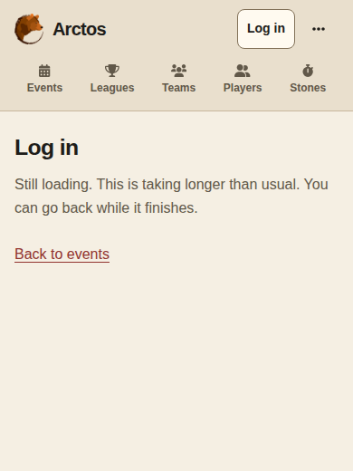

# Public documents and application startup

Flask serves event and league reading pages in the initial
HTTP response while Dioxus starts in the background. Reading navigation remains
available during startup; the application stays loaded after activation.
Both presentations use the existing mobile layout, navigation, palettes,
and account workflows.

Flask owns permissions, publication rules, data selection, and HTTP responses.
Dioxus owns interactive workflows and navigation after activation.

## Request and data ownership

`ARCTOS_PUBLIC_HTML_ENABLED=1` enables Flask's public document routing. The flag
defaults to `0`. Public pages use current database data and evaluate visibility
for each request. Interactive destinations display startup feedback while
Dioxus loads. Scoreboard, OBS, and side-competition scoring outputs retain their
dedicated layouts.

| Request with public routing enabled | Response |
| --- | --- |
| `/` with `q`, `view`, `page` | Events HTML |
| `/leagues` with `q`, `view`, `page` | Leagues HTML |
| Published `/<event>` and `?tab=info` | Event Info HTML |
| Published `/leagues/<league>` and `?tab=info` | League Info HTML |
| Authorized draft, `?app=1`, `?tab=app`, other event tabs | Application shell |
| Declared workflow routes | Application shell |
| Missing or inaccessible event/league | 404 document |
| Database failure during document selection | Recoverable 503 |
| Missing or incompatible application manifest | Public facts remain available; app entry returns 503 |

The route classifier in [`public_pages.py`](../app/routes/public_pages.py) and
the Rust `Route` enum must agree. APIs, assets, waivers, and authentication
callbacks keep their explicit owners. Within an active application, Dioxus
handles directory, Info, and workflow navigation in the same document.

[`PublicPageService`](../app/services/public_page_service.py) returns immutable,
request-scoped page models. The directory filters, sorts, counts, and paginates
in SQL. It selects 24 events per page, with a service limit of 48. Related
registration configuration, confirmed team counts, and personal status load in
batches for that page. `GET /_api/public/events` serializes the same
`DirectoryPage` model for Dioxus, preserving search, ordering, totals, and URLs.

[`PublicLeagueService`](../app/services/public_league_service.py) selects
24 leagues per page in SQL, with a service limit of 48. Name search is literal,
case-insensitive, and limited to 200 characters. Active/Past counts reflect the
query. A season remains active while any round is current or upcoming; seasons
without dated rounds are active. Only visible rounds contribute displayed dates
and counts. Hidden future rounds can keep a season active without revealing their
details. Dioxus applies the same 24-item pagination and filtered counts to its
account-scoped league-list response.

Search covers event names, locations, and visible league names. SQLite uses a
deterministic Unicode lowercase function; PostgreSQL uses `ILIKE`. Literal
wildcards are escaped. Event dates remain calendar dates. Upcoming/Past uses a
validated `arctos_timezone` cookie, falling back to
`ARCTOS_PUBLIC_CALENDAR_TIMEZONE` (UTC). The appearance script records the
browser's timezone for subsequent requests, so the first visit can use a
different day boundary near midnight.

Event models contain public facts, sanitized descriptions, permitted actions,
and the current account's registration/payment/waiver status. League events
use the league's registration scope. Access checks govern private league names,
schedule links, and organizer controls. Registration, editing, payment, and
waiver mutations continue through their authenticated APIs.
League Info includes its description, visible round summaries, live registration fees,
capacity, waiver requirements, and the visitor's own status. Rosters and payment
instructions remain in their existing application workflows.

## Presentation and startup

Jinja templates in `templates/public/` use the application's component classes.
`prepare_public_assets.py` copies vendored Bootstrap and generates `design.css`
and `theme.css` from the frontend styles. Generated CSS is ignored by Git and
prepared by development, test, and release commands. `public.css` adapts native
forms, disclosures, and startup feedback. Inline SVG icons use the existing
Font Awesome glyphs. Appearance and introduction preferences use the application's storage
keys.

At enlarged text sizes, header controls wrap and the navigation row scrolls
horizontally to keep labels intact. Both presentations measure the header so
fragment targets remain visible below it. Event date filters wrap within the
available width. The public header observer stops when the application takes
over the screen.

Content documents use `background.js` to import the verified module after two
animation frames and an idle opportunity, bounded to 1.5 seconds. An early
interactive navigation starts that import immediately. Router remains parked while the
server document is visible. While startup is pending or has failed, marked
reading links and GET forms fetch fresh Flask HTML and replace the public
document in place. Events, Leagues, their Info pages, filters, and pagination
remain usable while that single download continues. Each response must match
the origin, deployment prefix, and application manifest; fetched scripts are
discarded. A newer destination cancels and supersedes an earlier request.

When the runtime is ready, the `arctos:navigate` bridge accepts a same-origin
application URL and activates its Router. The public page remains visible until
the requested route and application styles are ready. Its IDs and their
accessible references are temporarily namespaced so the mounting application
can initialize safely. Handoff removes the public document and focuses the
application content. A failed first mount detaches the failed application,
restores the public page's IDs, address, and title, and offers a native link to
the requested destination.

Interactive entries preload the module and run `boot.js` asynchronously. The
status identifies the destination and displays “Loading…”. Handoff waits for
route content and application styles; Dioxus then owns the route's loading,
empty, error, and content states. The temporary header is hidden in the same
task that reveals the application. Focus moves to the application content when
a focused startup control disappears.

The image shows Log in at a 390px viewport with the runtime download held past
five seconds.

After five seconds, startup explains that opening is taking longer than usual.
Interactive entry offers Retry after 20 seconds and immediately on failure.
Public navigation offers a native
recovery link while startup is delayed and restores the public document if its
first route fails to mount. JavaScript-disabled interactive entries explain the
requirement to enable JavaScript.

## Navigation and caching

Ordinary navigation retains one Dioxus instance. Refreshes, new tabs, external
links, and dedicated output documents begin their own document lifecycle.
Modified clicks, downloads, and same-page fragments use native browser behavior.
The history adapter preserves raw query strings, fragments, return parameters,
and Back/Forward. Directory state preserves filters and pagination. Scroll
restoration waits for matching route content and yields to user input.
Before application activation, Back/Forward fetches the destination's current
permission-checked HTML and restores its saved position. Those history entries
use the same `[x, y]` state as Dioxus. Appearance controls and header measurements
rebind after each public document replacement.

| Resource | Cache behavior |
| --- | --- |
| HTML documents and `/_api/public/events` | `private, no-store`; publication and account state evaluated per request |
| Fingerprinted application assets and versioned presentation assets | Browser caching, validators, gzip negotiation, and immutable cache headers |
| Flask asset fallback with session cookies | Private response to protect cookie refresh headers |
| Leagues data | One successful response in memory for 60 seconds, keyed by account and calendar day |

Leagues writes, account changes, expiry, and Retry refresh the relevant data.
Invalidation rejects results from older in-flight requests. Read-only Markdown
rendering preserves the cache. The Events directory uses bounded page requests.
Directories ignore superseded responses and hide data from the previous account
while fresh data loads.

Registration URLs open either registration or the existing registration editor
according to current status. League registration redirects to the league route.
Save, cancel, withdrawal, and roster access retain their existing workflows.

## HTTP, indexing, and deployment

Canonical and Open Graph URLs use the configured `ARCTOS_PUBLIC_ORIGIN`.
Publication flags determine indexing for public app sections; privileged
workflows and previews receive `noindex`. The full route policy is in
[indexing](public-html-indexing.md). Interactive entries retain that classification,
while their initial HTML contains startup feedback. Schedules, results,
profiles, and other application pages obtain their content through Dioxus.
Public reading navigation updates title, description, robots, canonical, and
Open Graph tags from the server response. Application handoff removes those
document-specific tags; Layout manages the application title. A direct request
continues to obtain authoritative metadata from Flask.

[`frontend_shell.py`](../app/services/frontend_shell.py) validates the prepared
entry manifest and deployment prefix. Build preparation creates gzip companions;
staging revalidates the build, retains prior fingerprinted assets, and publishes
the manifest last. Deployment requires Flask document routing, a matching
frontend build, and
reverse-proxy configuration. See [deployment](DEPLOY.md#public-html-rollout)
and [environment variables](env-vars.md).

Performance checks run through standalone Playwright tools and write local
reports. Startup observers and timers control UI state; measurement observers
are injected by the external tools. See [verification](public-html-verification.md)
for acceptance criteria, commands, evidence, and deployment validation limits.
